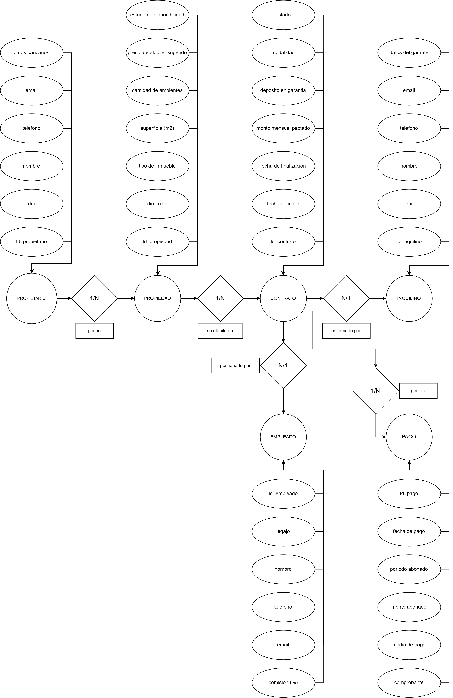

# BASE DE DATOS — Ejercicio 16: Gestión de Inmobiliaria y Alquileres Temporarios/Permanentes

Trabajo práctico de Base de Datos (Universidad Champagnat). Este repositorio contiene todo el desarrollo del ejercicio 16: modelo entidad-relación, modelo relacional y normalización (1FN, 2FN y 3FN).

## Consigna


#### Contexto

Una agencia inmobiliaria necesita un sistema centralizado para gestionar su cartera de propiedades (casas, departamentos, locales comerciales), administrar la relación con los propietarios e inquilinos, y formalizar contratos de locación y ventas.


#### Consigna

Construir el modelo entidad-relación para la inmobiliaria basándose en los siguientes requerimientos:

La inmobiliaria registra a sus propietarios e inquilinos, almacenando DNI/CUIT, nombre y apellido, teléfono de contacto y correo electrónico.

Las propiedades se identifican por su código catastral, dirección, ciudad, tipo de propiedad, superficie en metros cuadrados, cantidad de ambientes y precio de tasación o alquiler. Una propiedad pertenece a un único propietario.

Las operaciones inmobiliarias se clasifican en dos modalidades: Alquiler (temporario o permanente) y Venta.

Un contrato de alquiler vincula a un inquilino con una propiedad, registrando la fecha de inicio, fecha de finalización, monto mensual del canon locativo, depósito en garantía y el agente inmobiliario (empleado de la firma) comisionista.

Los pagos mensuales de alquiler deben registrarse detallando el período abonado, fecha efectiva de pago, monto abonado, medio de pago utilizado (Transferencia, Efectivo, Tarjeta) y recargo por mora si correspondiera.


#### Desarrollo requerido


Identificar las entidades del dominio inmobiliario (Propietario, Inquilino, Propiedad, Empleado/Agente, Contrato, Pago).

Establecer la cardinalidad entre Propietario y Propiedad (1:N).

Modelar el Contrato de Alquiler como entidad asociativa que vincula la Propiedad, el Inquilino y el Empleado responsable.

Diseñar la relación 1:N entre Contrato y sus respectivos Pagos mensuales efectuados.

## Estructura del repositorio

```
BASE_DE_DATOS_Ejercicio_16/
├── README.md
├── modelo-er/
│   ├── ejercicio_16.drawio        # diagrama editable (draw.io)
│   └── ejercicio_16.png           # exportación del diagrama
├── modelo-relacional/
│   ├── ejercicio_16_MR.xlsx               # modelo relacional
│   └── ejercicio_16_con_datos.xlsx        # modelo relacional con datos de ejemplo
└── normalizacion/
    ├── ejercicio_16_1FN.xlsx
    ├── ejercicio_16_2FN.xlsx
    └── ejercicio_16_3FN.xlsx
```

## Modelo entidad-relación



Archivo editable: [`modelo-er/ejercicio_16.drawio`](modelo-er/ejercicio_16.drawio).

## Modelo relacional

Tablas del modelo relacional original, antes de normalizar (`(PK)` clave primaria, `(FK)` clave foránea, `(UNIQUE)` valor único):

- **PROPIETARIO**: `Id_propietario(PK)`, `dni(UNIQUE)`, `nombre`, `telefono`, `email`, `datos bancarios`
- **PROPIEDAD**: `Id_propiedad(PK)`, `direccion`, `tipo de inmueble`, `superficie (m2)`, `cantidad de ambientes`, `precio de alquiler sugerido`, `estado de disponibilidad`, `Id_propietario(FK)`
- **INQUILINO**: `Id_inquilino(PK)`, `dni(UNIQUE)`, `nombre`, `telefono`, `email`, `datos del garante`
- **EMPLEADO**: `Id_empleado(PK)`, `legajo(UNIQUE)`, `nombre`, `telefono`, `email`, `comision (%)`
- **CONTRATO**: `Id_contrato(PK)`, `fecha de inicio`, `fecha de finalizacion`, `monto mensual pactado`, `deposito en garantia`, `modalidad`, `estado`, `Id_propiedad(FK)`, `Id_inquilino(FK)`, `Id_empleado(FK)`
- **PAGO**: `Id_pago(PK)`, `fecha de pago`, `periodo abonado`, `monto abonado`, `medio de pago`, `comprobante`, `Id_contrato(FK)`

Archivos: [`ejercicio_16_MR.xlsx`](modelo-relacional/ejercicio_16_MR.xlsx) y [`ejercicio_16_con_datos.xlsx`](modelo-relacional/ejercicio_16_con_datos.xlsx).

## Lógica relacional

Cada entidad se convierte en una tabla con su clave primaria. Las relaciones se representan así:

- **1:N / N:1**: la clave primaria del lado "uno" se copia como clave foránea (FK) en la tabla del lado "muchos".
- **1:1**: igual que 1:N, pero la FK lleva restricción UNIQUE.
- **N:M**: se crea una tabla intermedia cuyas FK forman una clave compuesta, junto con una clave propia que se identifica por esa combinación.

Relaciones del modelo final (3FN):

- `PROPIEDAD` → `PROPIETARIO`: **N:1** (FK `id_propietario` en `PROPIEDAD`).
- `INQUILINO` → `GARANTE`: **N:1** (FK `id_garante` en `INQUILINO`).
- `CONTRATO` → `PROPIEDAD`: **N:1** (FK `id_propiedad` en `CONTRATO`).
- `CONTRATO` → `INQUILINO`: **N:1** (FK `id_inquilino` en `CONTRATO`).
- `CONTRATO` → `EMPLEADO`: **N:1** (FK `id_empleado` en `CONTRATO`).
- `PAGO` → `CONTRATO`: **N:1** (FK `id_contrato` en `PAGO`).

## Normalización

Los cambios se muestran etapa por etapa; cada etapa parte del resultado de la anterior.

### Primera forma normal (1FN)

- `PROPIETARIO`: se quitan `datos bancarios`
- `PROPIETARIO`: se agregan `banco`, `ultimos 4 digitos del cbu`
- `PROPIEDAD`: se quitan `direccion`
- `PROPIEDAD`: se agregan `calle`, `numero`, `piso o departamento`, `ciudad`
- `INQUILINO`: se quitan `datos del garante`
- `INQUILINO`: se agregan `nombre del garante`, `parentesco del garante`, `dni del garante`

### Segunda forma normal (2FN)

Sin cambios respecto de la etapa anterior: el modelo ya cumplía esta forma normal.

### Tercera forma normal (3FN)

- Tablas nuevas: `GARANTE`
- `INQUILINO`: se quitan `nombre del garante`, `dni del garante`
- `INQUILINO`: se agregan `id_garante`

#### Modelo final en 3FN

- **PROPIETARIO**: `Id_propietario(PK)`, `dni(UNIQUE)`, `nombre`, `telefono`, `email`, `banco`, `ultimos 4 digitos del CBU`
- **PROPIEDAD**: `Id_propiedad(PK)`, `calle`, `numero`, `piso o departamento (opcional)`, `ciudad`, `tipo de inmueble`, `superficie (m2)`, `cantidad de ambientes`, `precio de alquiler sugerido`, `estado de disponibilidad`, `Id_propietario(FK)`
- **INQUILINO**: `Id_inquilino(PK)`, `dni(UNIQUE)`, `nombre`, `telefono`, `email`, `Id_garante(FK)`, `parentesco del garante`
- **GARANTE**: `Id_garante(PK)`, `dni(UNIQUE)`, `nombre`
- **EMPLEADO**: `Id_empleado(PK)`, `legajo(UNIQUE)`, `nombre`, `telefono`, `email`, `comision (%)`
- **CONTRATO**: `Id_contrato(PK)`, `fecha de inicio`, `fecha de finalizacion`, `monto mensual pactado`, `deposito en garantia`, `modalidad`, `estado`, `Id_propiedad(FK)`, `Id_inquilino(FK)`, `Id_empleado(FK)`
- **PAGO**: `Id_pago(PK)`, `fecha de pago`, `periodo abonado`, `monto abonado`, `medio de pago`, `comprobante`, `Id_contrato(FK)`

Archivos: [`ejercicio_16_1FN.xlsx`](normalizacion/ejercicio_16_1FN.xlsx), [`ejercicio_16_2FN.xlsx`](normalizacion/ejercicio_16_2FN.xlsx), [`ejercicio_16_3FN.xlsx`](normalizacion/ejercicio_16_3FN.xlsx).
